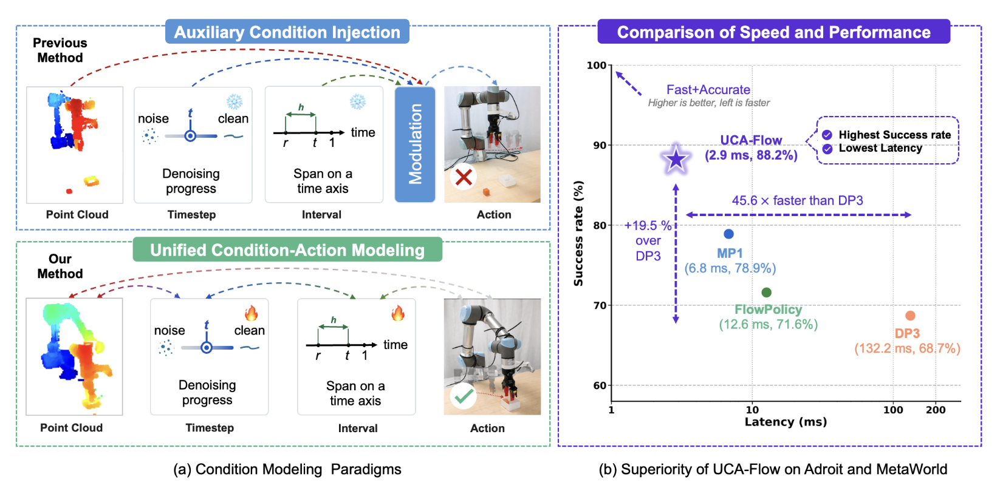
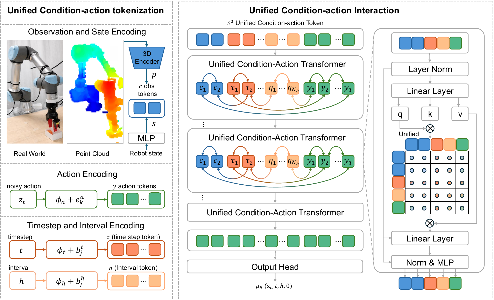

# UCA-Flow

Official implementation of **Unified Condition-Action Modeling for Accurate One-Step Action Generation**.

[[Project Page](https://uca-policy.github.io/UCA.github.io/)]
[[Paper](https://arxiv.org/abs/2608.16153)]

## Overview

UCA-Flow represents observation, timestep, interval, and action tokens in one
sequence and jointly updates them with a compact Unified Condition-Action
Transformer. The policy uses dual-pass supervision during training and produces
an action trajectory in one network evaluation at inference time.

## Motivation

**The key question is how to model conditions and actions together, not just
how to generate actions in one step.** Many generative robot policies encode
conditions as external guidance and inject them into the action backbone
through modulation or cross-attention. UCA-Flow instead treats conditions and
actions as a unified sequence of tokens that are jointly updated, allowing
condition representations to adapt to the current action-generation state.

This design aims to emphasize task-relevant information about the manipulator
and objects while improving the accuracy-efficiency trade-off. In the paper's
Adroit and Meta-World evaluation, UCA-Flow achieves an average success rate of
88.2% with 2.9 ms inference latency, improving success by 9.3 percentage points
over the strongest baseline.



## Pipeline



1. **Unified tokenization:** encode observations and robot state, the noisy
   action chunk, timestep, and interval as tokens in a shared sequence.
2. **Joint condition-action interaction:** update all tokens with a shared
   Unified Condition-Action Transformer, rather than keeping conditions as
   fixed external context. The output head uses the final action tokens to
   predict the interval-aware velocity.
3. **Training and inference:** train with dual-pass supervision over average
   velocity `u` and instantaneous velocity `v`. At inference, use the average
   velocity prediction to generate an action chunk in one network evaluation.

## Installation

Clone the repository and follow [install.md](install.md):

```bash
git clone https://github.com/Juggler8338/UCA.git
cd UCA
```

## Data, Training, and Evaluation

Demonstration-generation, training, and evaluation commands are provided in
the [`scripts`](scripts) directory. Generated data and model checkpoints are
excluded from version control by default.

For UR5 deployment and calibration, see
[`UCA/README_deployur5.md`](UCA/README_deployur5.md).

## Citation

```bibtex
@misc{zhou2026unifiedconditionactionmodelingaccurate,
  title={Unified Condition-Action Modeling for Accurate One-Step Action Generation},
  author={Xinyu Zhou and Zikun Cai and Kuangji Zuo and Gen Li and Boyu Ma and Yanshuo Lu and Yutong Song and Mingqi Yuan and Jiayu Chen and Jianfei Yang},
  year={2026},
  eprint={2608.16153},
  archivePrefix={arXiv},
  primaryClass={cs.RO},
  url={https://arxiv.org/abs/2608.16153},
}
```

## Acknowledgements

We thank the authors and maintainers of the open-source research code and
environments used in this implementation, including 3D Diffusion Policy,
FlowPolicy, MeanFlow, VRL3, and Meta-World. Code provenance and upstream
attribution are documented in
[Third-Party Notices](THIRD_PARTY_NOTICES.md).

## License

UCA-Flow-specific contributions are released under the [MIT License](LICENSE).
Reused code retains its original copyright and license notices; see
[Third-Party Notices](THIRD_PARTY_NOTICES.md) and the
[MP1-derived code's MIT notice](LICENSES/MP1-MIT.txt).
Components in `third_party` and source files carrying their own license headers
remain subject to their respective licenses.
